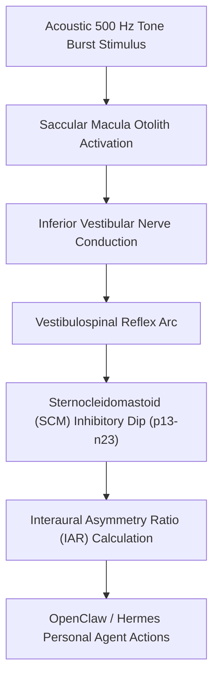

# Cervical Vestibular Evoked Myogenic Potentials (cVEMP) Skill

[](LICENSE)
[](https://www.python.org/)
[](requirements.txt)
[](mcp_server.py)
[](SKILL.md)

Zero-dependency sovereign personal agent skill for non-invasive evaluation of Cervical Vestibular Evoked Myogenic Potentials (cVEMP), p13-n23 peak latencies, Interaural Asymmetry Ratio (IAR), and saccular otolith integrity.



## Features
- **Deterministic Math**: Pure Python standard library implementation with zero external dependencies.
- **Vestibular Electrophysiology Standards**: Formulates p13 and n23 peak latencies, background tonic SCM EMG normalization, and Jongkees interaural asymmetry.
- **Saccular Otolith Resilience**: Detects unilateral vestibular hypofunction, Tullio phenomenon, and linear acceleration perception decline.
- **Model Context Protocol (MCP)**: Native JSON-RPC tool integration for LLMs and autonomous agents.

## Quickstart

```python
from client import CervicalVEMPClient

client = CervicalVEMPClient()
result = client.evaluate_cvemp(
    p13_latency_ms=13.2,
    n23_latency_ms=22.4,
    peak_to_peak_amplitude_uv=84.5,
    contralateral_amplitude_uv=79.0,
    mean_background_emg_uv=62.0
)
print("Interaural Asymmetry Ratio:", result["interaural_asymmetry_ratio_pct"], "%")
print("Classification:", result["classification"])
```

## License
Apache-2.0
